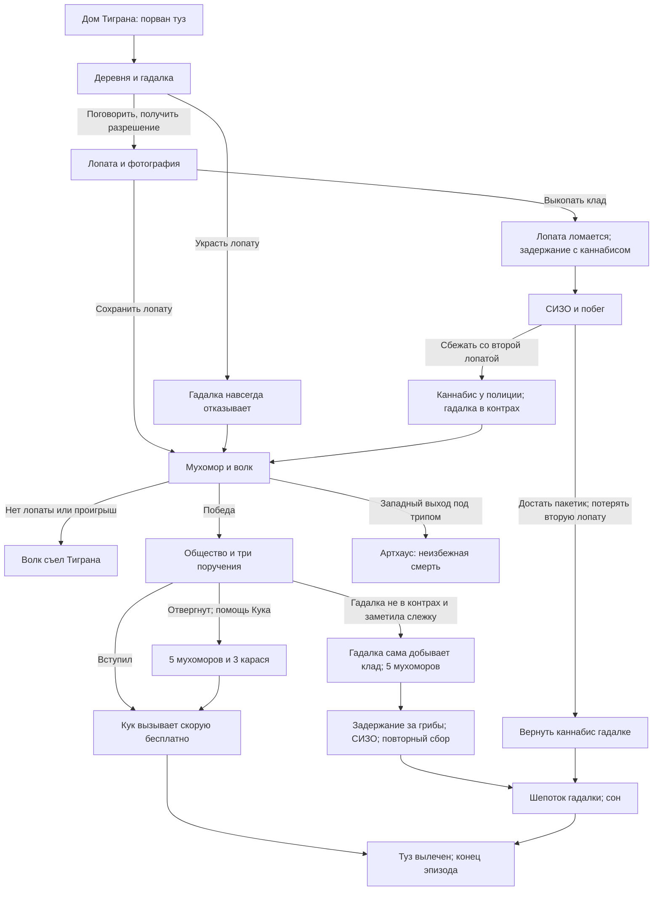

# Сюжет, переходы и концовки первого эпизода

> Утверждённые события и варианты. Там, где последовательность ещё не определена, это прямо указано. Детали СИЗО из последнего предложения помощника приняты автором, кроме специально отмеченных открытых вопросов.

## Карта истории

Схема сокращённая: провалы, альтернативное обращение к гадалке и пасхалки расписаны ниже. Встреча с полицией в ветке каннабиса обязательна как утверждённая сюжетная последовательность; конкретное место срабатывания ещё определить.

## Предыстория и начало

Тигран живёт в деревне и считает, что городские в драке порвали ему туз бутылкой. Гадалка просит принести закопанный каннабис: для сложного шепотка ей нужно курнуть и набраться сил. После шепотка герой спит и просыпается здоровым. Никакой заплатки и произнесения шепотка самим Тиграном; гадалка не отзывает выданное заклинание.

Фотографию тайника можно рассматривать в инвентаре. На новой игре место тайника определяется из возможных точек. Важно, чтобы герой не получал знание о кладе после кражи лопаты до разговора и не мог случайно выкопать его в этой ветке.

## Лопата и доступ к лесным путям

- Первую лопату берут с разрешения или крадут до разговора. Кража навсегда лишает помощи гадалки; вернуть доверие нельзя.
- Лопата не ломается на неверном месте; пять неверных раскопок с разрешением и фотографией дают «Ненаход». Успешная раскопка ломает её. Запасной лопаты у гадалки нет.
- С целой лопатой, украденной или полученной честно, можно пройти волка. Пока Тигран носит выкопанный клад, первой лопаты у него нет.
- После задержания с каннабисом можно найти вторую лопату на пути к вещдокам. До выбора у вещдоков Тигран имеет лопату и не имеет пакетика; после выбора может сбежать только с чем-то одним.
- Если герой после кражи не знает о кладе, копание не должно случайно сломать лопату или добыть пакетик. Системные запреты и подсказки должны соответствовать его знанию.

## Побег после задержания с каннабисом

Камера, в которой сидит Евсобий Подшконарный в костюме петуха. Евсобий шутит и задаёт три загадки; в побеге не участвует.

Принятая последовательность побега: осмотреть камеру; организовать ситуацию с текущей водой, чтобы дежурный вошёл, и проскользнуть через дверь; пройти коридоры, наблюдая за охраной и распорядком; добраться до выхода. Для версии с каннабисом Тигран отказывается просто уйти: «А смысл бежать без каннабиса?» Он идёт к вещдокам, находит лопату и видит пакетик за решёткой. Точное устройство помещений, маршруты и формулировки — производственная проработка, не новые сюжетные факты.

У решётки он ссыт и выбирает:

1. **Сбежать с лопатой.** Каннабис остаётся в вещдоках; гадалка в контрах и не помогает. Лопата позволяет биться с волком. На речке рыбак рассказывает о скрытом обществе и мухоморе.
2. **Достать каннабис.** Тигран поддевает пакетик лопатой, подтягивает к решётке и забирает, но случайно выпускает лопату внутрь комнаты. Она остаётся в вещдоках. Падение поднимает тревогу; он убегает с пакетиком и без лопаты.

Поимка при побеге — окончательная плохая концовка: отправка на зону с порванным тузом. Версии с каннабисом и мухоморами используют общее СИЗО, но поиск вещдоков обязателен только в первой версии.

## Мухомор, волк и общество

Чтобы путь к волку открылся, Тигран должен хотя бы один раз съесть мухомор. Если уже ел, повторять необязательно. Без целой лопаты волк съедает Тиграна. С лопатой — бой из пяти проверок; промах или неуспех заканчивается смертью. Победа ломает лопату и открывает доступ к поселению и дому общества.

Общество — важная сюжетная линия и путь к скорой. Капитан Кук выдаёт три поручения: слежка, вынос красного стула из особняка, хоровод со стульями. Красный стул — символ вуайериста. Общество не нуждается в искусственно придуманной глубокой предыстории.

## Поручение 1: слежка

Успех — гадалка не обнаружила Тиграна. Если клад ещё закопан, она идёт за ним. Если пакетик остался у полиции после побега с лопатой, она собирает мухоморы; Тигран докладывает об этом Куку и получает второе поручение.

Обнаружение означает провал поручения, а не автоматический зачёт. Если Тигран не крал и не пропадал с каннабисом, гадалка думает, что он ищет клад или заблудился, сама выкапывает каннабис и затем отправляет его за пятью мухоморами. Если украл лопату либо пропал с пакетиком, гадалка в контрах и накладывает порчу. Провал означает отвержение как кандидата в общество; после выживания Кук может помочь вызвать скорую за дополнительное задание.

Потеря цели из виду и подробности повторной попытки, если гадалка не обнаружила героя, отдельно не утверждены — не приравнивать автоматически к обнаружению.

## Мухоморы для гадалки и СИЗО

Если гадалка сама добыла клад и просит пять мухоморов, Тигран берёт корзинку и собирает их. После пятого гриба подходит полицейский: он удивляется, что мухоморы якобы съедобны, и хочет выяснить в участке, зачем гражданину целая корзинка. Тиграна забирают в СИЗО, вещи изымают. Поимка при побеге — зона и плохая концовка. После удачного побега он берёт дома другую корзинку и собирает пять мухоморов заново. Повторного задержания на пятом грибе нет. Гадалка читает шепоток; после сна туз вылечен.

Если после поражения в хороводе гадалка ещё не в контрах, она тоже может попросить мухоморы, и герой может выбирать её путь или помощь Кука. **Открыто:** запускается ли задержание на пятом грибе и в этом конкретном случае либо оно ограничено поручением после самостоятельно выкопанного гадалкой клада. Не додумывать молча.

## Поручение 2: особняк

Красный стул находится на втором этаже. Его нужно вынести; попадание в поле зрения гадалки приводит к порче вместо старого повторного старта у входа. Первая порча запускает бег домой к туалету, неуспех — смерть. Успевший больше не становится членом общества, но может обратиться к Куку за скорой через задание с грибами и карасями.

Если позже нужна удочка, герой может проникнуть в особняк именно за ней, даже если не дошёл до задания со стулом. При повторной встрече с гадалкой, уже наложившей порчу, — мгновенная смерть. Место начала бега из особняка и детальная постановка сцены ещё требуют реализации и проверки маршрута.

## Поручение 3: хоровод

Три круга игры со стульями. Победа — членство, красный стул, Кук вызывает скорую без дополнительных условий. Провал — отвержение обществом; повторное прохождение для вступления не предусмотрено. Кук предлагает помощь за пять мухоморов и трёх карасей. Если гадалка не в контрах, можно вместо этого пойти к ней и выполнить её просьбу с мухоморами.

## Порча и скорая после отвержения

Первое обнаружение гадалкой во время соответствующих эпизодов слежки или проникновения в особняк вызывает порчу и бег к домашнему унитазу через нужные локации. Таймер и проверки выдержки уже существуют, но необходимо поддержать запуск из особняка. Успех сохраняет факт первой порчи и провала испытания; второй раз при встрече за удочкой — мгновенная смерть. Провал бега — смерть от доразрыва туза.

Кук даёт ведро и просит пять мухоморов и трёх карасей. Тигран замечает, что грибы и рыбу негоже складывать в одно ведро, и идёт за корзинкой домой. После выполнения Кук вызывает скорую; короткая кат-сцена заканчивает лечение. Если герой член общества, это поручение не нужно.

## Колодец и побочные действия

Куколд — фан-персонаж, член общества, более агрессивный вуайерист. Викторина и соответствующая ачивка существуют ради фана. Колодец и река не требуют сюжетного расширения. Прыжок, провал викторины или несчастный случай при рыбалке в колодце приводят к утоплению и смертельной концовке «Водолаз колодца»; название содержит отсылку, а не означает выживание. Рыбак во время задания Кука советует колодец: последовавший совету рискует этой концовкой.

Питбайк, тряпка, обычная рыбалка, лесной лагерь и прочие существующие шуточные взаимодействия остаются необязательными, если не противоречат новым состояниям. Рыбак и Куколд не получают навязанной серьёзной предыстории.

## Водник

Пока каннабис не скурен, его можно принести гадалке. Если Тигран использует его дома через водник, наступает смерть от доразрыва туза. Бега к туалету нет; старый самостоятельный финал «Проклятие гадалки» заменяется или объединяется с этим исходом. Точный внешний вид экрана смерти можно уточнить без изменения результата.

## Пасхалка «Преступление и наказание»

Не показывать как очевидный пункт диалога. Тигран подходит к гадалке, выбирает целую лопату в инвентаре и использует её в зоне взаимодействия: сносит ей голову. Лопата ломается. После смены локации и возвращения к дому гадалки у дома стоят полиция и сосед, который указывает, что видел Тиграна выходящим от неё. Тиграна ловят и отправляют на зону с порванным тузом. Плохая концовка и достижение «Преступление и наказание». Не писать реакцию убитой гадалки после удара.

## Артхаусная концовка «Туз подождёт»

Если после мухомора выйти из леса в деревню, галлюцинации продолжаются. К Тиграну подходит гриб и велит съесть себя; герой съедает его без выбора, идёт домой и засыпает. Первый день — утро после этого сна. Это отдельная ветка: к обществу и реке под трипом попасть нельзя, из неё нет выздоровления.

По дням нужно поддерживать эйфорию грибами. Съел гриб при уже полной шкале — передозировка и смерть. Лёг спать, не набрав необходимого дневного уровня — истощение и смерть. Мир постепенно меняется: фиолетовая трава, жёлтое небо, деревья — огромные мухоморы, грибы светятся, дома превращаются в чаны с борщом. На третий день каждый чан можно наполнить белой массой, выдавливая в него майонез. Концовка неизбежно смертельна: ресурса не хватает к пятому дню даже при минимальном расходе. Точный расчёт — в systems.md.

## Реестр исходов

| Исход | Условие | Результат |
|---|---|---|
| Шепоток | Гадалка помогает после её условий; сон | Вылечен, конец эпизода |
| Скорая: член | Три поручения пройдены | Вылечен, членство сохраняется |
| Скорая: не член | Кук помогает после отвержения; 5 грибов и 3 карася | Вылечен, членства нет |
| Волк | Нет лопаты или проигран бой | Съеден |
| Порча / доразрыв | Не успел к туалету; либо вторая порча; либо водник | Смерть; конкретный триггер хранить отдельно |
| Водолаз | Попал в колодец | Утонул |
| СИЗО | Пойман при побеге | Зона, плохой финал |
| Преступление и наказание | Убил гадалку, сменил локацию и вернулся | Полиция, зона, плохой финал |
| Туз подождёт | Артхаусная последовательность | Передозировка или истощение |

Сколько отдельных карточек и названий показывать в галерее для разных смертей от порчи — открытый вопрос; не терять причину исхода внутри состояния.
